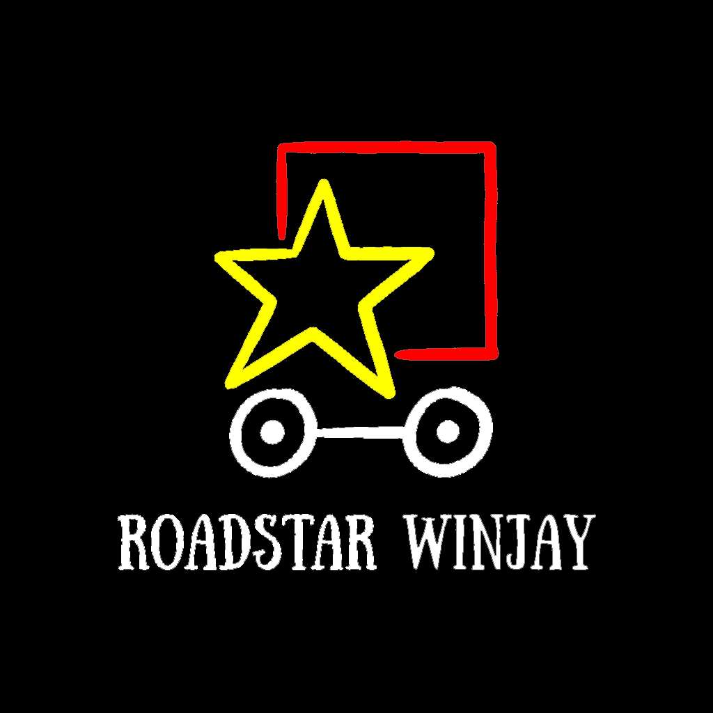

# RoadStar Winjay

<p align="center">
  
</p>

RoadStar Winjay is an all-in-one logistics, load matching, and fleet management platform, designed for modern dispatching.

## Features Built
- **Fleet Hub**: Manage your vehicles and drivers database.
- **Load Planner**: 3D Visualization and Bin-Packing algorithm for optimal cargo loading.
- **Crew & Route**: Driver schedule management and interactive route planner with OpenStreetMap & OSRM integration.
- **Dispatch**: Kanban-style Dispatch Board with smart match suggestion between loads and available fleet.
- **Insight AI**: Predictive analytics on delay risks, maintenance alerts, and an AI-generated executive summary.
- **Integrations**: Bulk Import/Export via CSV and a documented REST API.

## Tech Stack
- **Frontend**: React (Vite), TypeScript, Tailwind CSS, Three.js (for 3D), React-Leaflet (for maps).
- **Backend**: Node.js, Express, TypeScript. (In-memory mock data for demo purposes).

## How to Run

### 1. Backend
Navigate to the `backend` directory, install dependencies, and run the server:
```bash
cd backend
npm install
npm run dev
```
The backend will run on `http://localhost:3001`.

### 2. Frontend
Navigate to the `frontend` directory, install dependencies, and run the development server:
```bash
cd frontend
npm install
npm run dev
```
The frontend will run on `http://localhost:5173`.

## MIT License

Copyright (c) Winjay

Permission is hereby granted, free of charge, to any person obtaining a copy
of this software and associated documentation files (the "Software"), to deal
in the Software without restriction, including without limitation the rights
to use, copy, modify, merge, publish, distribute, sublicense, and/or sell
copies of the Software, and to permit persons to whom the Software is
furnished to do so, subject to the following conditions:

The above copyright notice and this permission notice shall be included in all
copies or substantial portions of the Software.

THE SOFTWARE IS PROVIDED "AS IS", WITHOUT WARRANTY OF ANY KIND, EXPRESS OR
IMPLIED, INCLUDING BUT NOT LIMITED TO THE WARRANTIES OF MERCHANTABILITY,
FITNESS FOR A PARTICULAR PURPOSE AND NONINFRINGEMENT. IN NO EVENT SHALL THE
AUTHORS OR COPYRIGHT HOLDERS BE LIABLE FOR ANY CLAIM, DAMAGES OR OTHER
LIABILITY, WHETHER IN AN ACTION OF CONTRACT, TORT OR OTHERWISE, ARISING FROM,
OUT OF OR IN CONNECTION WITH THE SOFTWARE OR THE USE OR OTHER DEALINGS IN THE
SOFTWARE.
